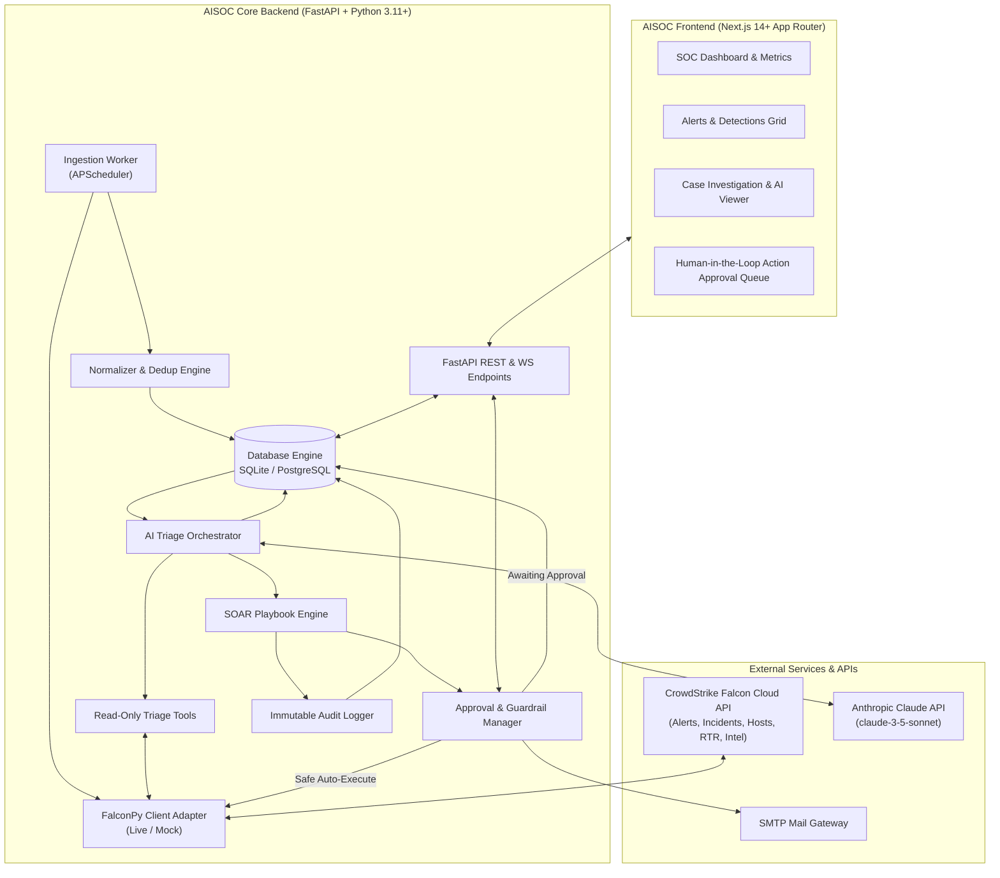

# Technical Requirement Document (TRD) — AISOC

## 1. System Architecture Overview

AISOC operates on a modular, decoupled architecture consisting of an asynchronous Python backend, a high-performance Next.js web application, an autonomous LLM triage runtime, and integrations with CrowdStrike Falcon and external notification services.

---

## 2. Technology Stack Matrix

| Layer | Component | Selection | Rationale |
|---|---|---|---|
| **Backend Framework** | Web API Server | **FastAPI** (`0.115+`) | High throughput (ASGI/uvicorn), native Pydantic v2 validation, automatic OpenAPI documentation. |
| **Language & Runtime** | Backend Language | **Python 3.11+** | Native support for modern typing, official CrowdStrike SDK (`crowdstrike-falconpy`), Anthropic SDK. |
| **ORM / Data Access** | Database Layer | **SQLAlchemy 2.0+** | Enterprise-grade ORM, async-compatible, seamless SQLite-to-PostgreSQL portability. |
| **Database** | Primary Datastore | **SQLite 3** (Dev/Edge) / **PostgreSQL 16** (Prod) | SQLite allows zero-dependency local runs; PostgreSQL provides multi-worker concurrency. |
| **Scheduler** | Background Polling | **APScheduler 3.10+** | In-process, cron/interval job orchestration without external Celery/Redis overhead in early stages. |
| **AI Intelligence** | LLM Engine | **Anthropic Claude 3.5 Sonnet** (`anthropic>=0.40`) | Industry-leading cybersecurity reasoning, precise JSON extraction, and robust tool-use abilities. |
| **Security Telemetry** | EDR / XDR SDK | **CrowdStrike FalconPy 1.4+** | Official CrowdStrike SDK with integrated OAuth2 token renewal, request retries, and comprehensive endpoint coverage. |
| **Frontend Framework** | Web Console | **Next.js 14+ (App Router)** | Server Components, fast client hydration, unified API routing, robust enterprise React ecosystem. |
| **Styling & Components**| Styling Engine | **Tailwind CSS + Lucide Icons** | Utility-first styling, standard dark-theme design tokens, lightweight component architecture. |

---

## 3. CrowdStrike Falcon API Specifications

### 3.1. Authentication & Scopes
Authentication uses OAuth2 Client Credentials grant (`POST /oauth2/token`). FalconPy automatically handles token caching and lifecycle refresh before expiration (30-minute default TTL).

Required API Scopes:
- `Alerts`: **Read** (v2 Query & Entities), **Write** (Update alert status)
- `Incidents`: **Read** (Query & Entities), **Write** (Update incident status)
- `Hosts`: **Read** (Device queries, detail extraction), **Write** (Network containment / lift containment)
- `Real time response`: **Read** (Session management), **Write** (Process kill, file deletion)
- `Custom IOCs`: **Read & Write** (Indicator block rules)
- `Threat Intel`: **Read** (Indicators, actor profiles, report summaries)
- `Spotlight Vulnerabilities`: **Read** (Host CVE assessment)

### 3.2. Polling & FQL Query Strategy
Alerts and Incidents are queried using CrowdStrike's **Falcon Query Language (FQL)**:
- Filter syntax: `created_timestamp:>='YYYY-MM-DDTHH:MM:SSZ'`
- Sort order: `created_timestamp.asc` (ensures incremental ingestion without missing events)
- High-Water Mark: Stored in `ingest_checkpoints` table.
- Pagination / Chunking: Detailed records are retrieved in batches (`composite_ids` capped at 500 per request).

---

## 4. AI Triage Agent Architecture

### 4.1. Prompting & Decision Flow
The AI agent runs a governed **Tool-Use Loop**:
1. Agent receives an alert containing process context, command-line, hash, user, and host data.
2. The agent executes read-only tools to gather supplemental intelligence:
   - `tool_get_host_posture(device_id)`
   - `tool_get_recent_host_alerts(device_id)`
   - `tool_lookup_threat_intel(sha256, ip, domain)`
   - `tool_get_host_vulnerabilities(device_id)`
3. The agent compiles an immutable evaluation in strict JSON conforming to `TriageVerdictSchema`.

### 4.2. Tool Guardrails
- **Read-Only Enforcement**: The AI execution harness strictly exposes read-only query tools. Response tools (`contain_host`, `block_hash`) are physically inaccessible to the LLM agent.
- **Prompt Injection Defense**: All untrusted inputs (command-line strings, filenames, URLs) are formatted inside structured delimiter blocks (`<telemetry_data>...</telemetry_data>`) with system instructions to treat content solely as data.

---

## 5. Security, Secrets & Audit Architecture

1. **Secret Management**:
   - Keys (`FALCON_CLIENT_SECRET`, `ANTHROPIC_API_KEY`, `SMTP_PASSWORD`) are loaded into `pydantic.SecretStr` instances.
   - String representations prevent leakage in log files, traceback dumps, or API serialized responses.
2. **Immutable Audit Ledger**:
   - Table `audit_log` is write-only.
   - Every status update, AI suggestion, analyst manual action, and SOAR execution writes:
     `{ id, ts, actor, event, target_type, target_id, details }`.
3. **CORS & Network Boundaries**:
   - API endpoints restrict origins to configured trusted web dashboard hosts (`CORS_ORIGINS`).

---

## 6. Development & Test Isolation
To permit safe development without contacting production infrastructure:
- **`FALCON_MOCK=true`**: MockFalconClient generates realistic multi-stage scenarios (Mimikatz memory dump, PowerShell encoded executions, VSSAdmin shadow copy deletion, Cobalt Strike beacons).
- Isolated test runner using temporary in-memory/file SQLite databases with zero global state leak.

