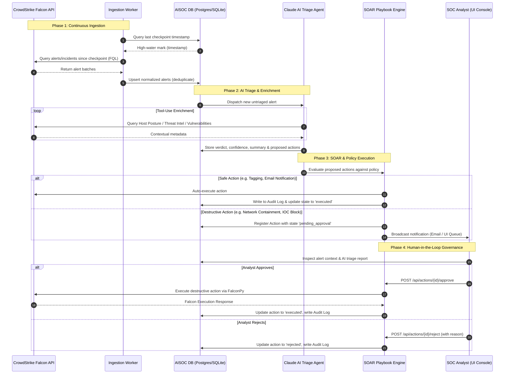
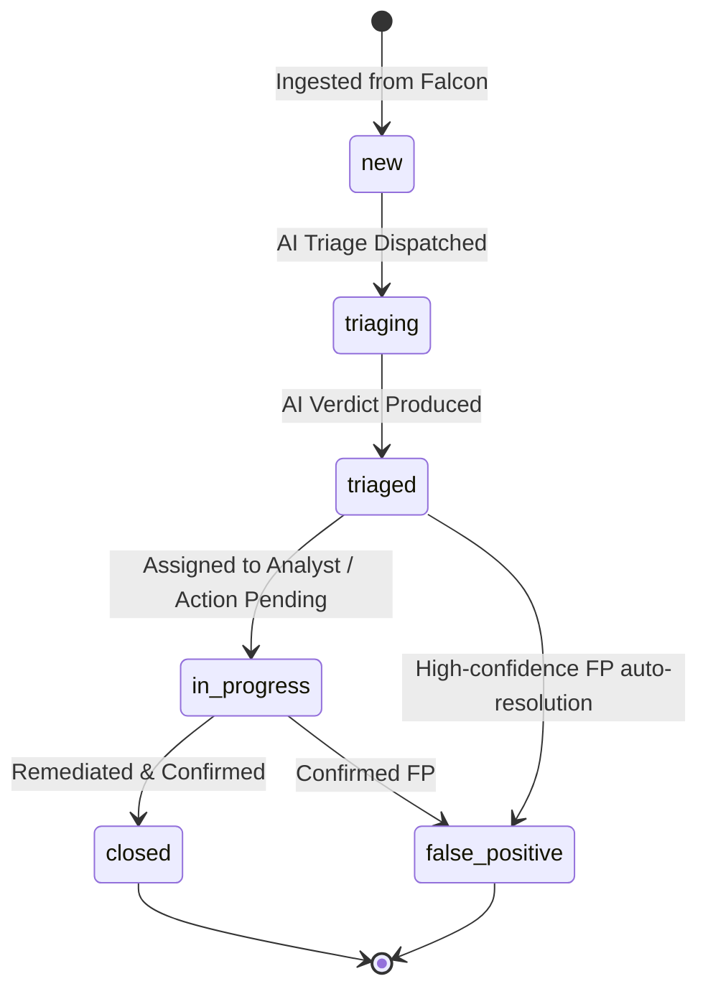
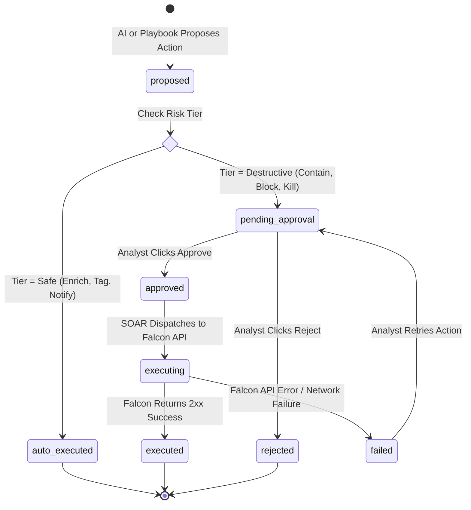

# Application Flow & State Machines — AISOC

## 1. End-to-End System Pipeline

---

## 2. State Machine Diagrams

### 2.1. Alert Lifecycle State Machine
Every alert ingested into AISOC progresses through defined states:

### 2.2. SOAR Action Lifecycle State Machine
Destructive actions are governed by an approval state machine:

---

## 3. Human-in-the-Loop Analyst Workbench Workflow

### Step 1: Real-Time Detection Monitoring
- Analyst observes live dashboard KPI counters (Critical/High counts, Host concentration).
- The alert stream auto-refreshes every 15 seconds or upon manual "Poll now" trigger.

### Step 2: Contextual Triage Review
- Clicking an alert opens the deep-dive inspection drawer.
- The drawer displays:
  - MITRE ATT&CK Tactic and Technique mapping.
  - Process execution details (`filename`, `cmdline`, `sha256`).
  - Target machine context (`hostname`, `platform`, `local_ip`, `user_name`).
  - **AI Triage Assessment**: Claude's plain-English narrative summary, confidence level, and rationale.

### Step 3: Action Approval & Execution
- In the **Approval Queue**, the analyst reviews proposed response steps:
  - Example: `contain_host(device_id="a1b2c3d4...")`
  - Impact Analysis: Informs the analyst of potential service disruption on `WS-FIN-014`.
- The analyst clicks **Approve** or **Reject**.
- If approved, the backend executes the action via FalconPy and immediately writes an immutable record to `audit_log`.

### Step 4: Resolution & Status Sync
- The analyst transitions the alert status (`triaged` → `in_progress` → `closed` or `false_positive`).
- The transition updates local records and optionally writes a comment back to CrowdStrike Falcon console.

