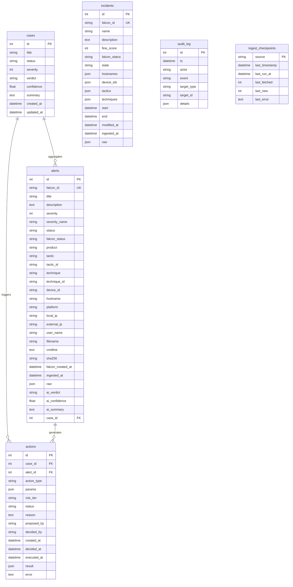

# Backend Schema & Data Models — AISOC

## 1. Entity-Relationship (ER) Diagram

---

## 2. Table Specifications & Indexes

### 2.1. `alerts`
Stores normalized endpoint detections pulled from CrowdStrike Falcon Alerts API v2.

| Column | Type | Nullable | Description / Constraints |
|---|---|---|---|
| `id` | `INTEGER` | No | Auto-incrementing primary key |
| `falcon_id` | `VARCHAR(512)` | No | Falcon composite ID (`CID:ind:device:aggregate`). **Unique Index**. |
| `title` | `VARCHAR(512)` | No | Alert display name |
| `description` | `TEXT` | Yes | Telemetry description |
| `severity` | `INTEGER` | No | Falcon 0–100 score. **Index** for filtering. |
| `severity_name`| `VARCHAR(32)` | No | `Critical`, `High`, `Medium`, `Low`, `Informational` |
| `status` | `VARCHAR(32)` | No | Internal AISOC workflow status (`new`, `triaging`, `triaged`, `in_progress`, `closed`, `false_positive`). **Index**. |
| `falcon_status`| `VARCHAR(64)` | Yes | Raw Falcon status string |
| `product` | `VARCHAR(64)` | Yes | Product source (e.g., `epp`, `identity`) |
| `tactic` | `VARCHAR(128)` | Yes | MITRE tactic name (e.g. `Execution`) |
| `tactic_id` | `VARCHAR(32)` | Yes | MITRE tactic ID (e.g. `TA0002`) |
| `technique` | `VARCHAR(256)` | Yes | MITRE technique name |
| `technique_id`| `VARCHAR(32)` | Yes | MITRE technique ID (e.g. `T1059.001`) |
| `device_id` | `VARCHAR(64)` | Yes | CrowdStrike Agent ID (AID). **Index**. |
| `hostname` | `VARCHAR(256)` | Yes | Host machine name. **Index**. |
| `platform` | `VARCHAR(64)` | Yes | `Windows`, `Linux`, `Mac` |
| `local_ip` | `VARCHAR(64)` | Yes | Internal IP address |
| `external_ip`| `VARCHAR(64)` | Yes | Public egress IP address |
| `user_name` | `VARCHAR(256)` | Yes | Executing user account |
| `filename` | `VARCHAR(512)` | Yes | Executable filename |
| `cmdline` | `TEXT` | Yes | Raw command line execution |
| `sha256` | `VARCHAR(64)` | Yes | File cryptographic hash. **Index**. |
| `falcon_created_at`| `DATETIME` | Yes | Falcon event creation timestamp (UTC). **Index**. |
| `ingested_at` | `DATETIME` | No | Local ingestion timestamp (UTC) |
| `raw` | `JSON` | No | Complete unaltered Falcon JSON payload |
| `ai_verdict` | `VARCHAR(32)` | Yes | `true_positive`, `false_positive`, `needs_review` |
| `ai_confidence`| `FLOAT` | Yes | Floating confidence score between 0.0 and 1.0 |
| `ai_summary` | `TEXT` | Yes | Claude plain-language assessment |
| `case_id` | `INTEGER` | Yes | FK referencing `cases.id`. **Index**. |

---

### 2.2. `incidents`
Aggregated security incidents derived from CrowdStrike Falcon Incidents API.

| Column | Type | Nullable | Constraints / Description |
|---|---|---|---|
| `id` | `INTEGER` | No | Auto-increment primary key |
| `falcon_id` | `VARCHAR(256)` | No | Falcon incident ID. **Unique Index**. |
| `name` | `VARCHAR(512)` | No | Incident title |
| `description` | `TEXT` | Yes | Incident description |
| `fine_score` | `INTEGER` | No | Falcon incident score (0–100) |
| `falcon_status`| `VARCHAR(32)` | Yes | Translated status (`New`, `In Progress`, `Closed`) |
| `state` | `VARCHAR(32)` | Yes | State string |
| `hostnames` | `JSON` | No | Array of affected hostnames |
| `device_ids` | `JSON` | No | Array of affected device IDs |
| `tactics` | `JSON` | No | Array of observed MITRE tactics |
| `techniques` | `JSON` | No | Array of observed MITRE techniques |
| `start` | `DATETIME` | Yes | Incident start time (UTC) |
| `end` | `DATETIME` | Yes | Incident end time (UTC) |
| `modified_at` | `DATETIME` | Yes | Falcon last modified timestamp. **Index**. |
| `ingested_at` | `DATETIME` | No | Ingestion timestamp |
| `raw` | `JSON` | No | Unaltered incident JSON |

---

### 2.3. `actions` (SOAR Response Registry)
Tracks automated and manual actions executed or proposed by the SOAR engine.

| Column | Type | Nullable | Constraints / Description |
|---|---|---|---|
| `id` | `INTEGER` | No | Auto-increment primary key |
| `case_id` | `INTEGER` | Yes | FK referencing `cases.id` |
| `alert_id` | `INTEGER` | Yes | FK referencing `alerts.id` |
| `action_type` | `VARCHAR(64)` | No | E.g. `contain_host`, `lift_containment`, `block_ioc`, `send_email` |
| `params` | `JSON` | No | Parameter payload (e.g. `{"device_id": "...", "sha256": "..."}`) |
| `risk_tier` | `VARCHAR(16)` | No | `safe` (auto-run) or `destructive` (needs approval) |
| `status` | `VARCHAR(32)` | No | `pending_approval`, `approved`, `rejected`, `executed`, `failed`. **Index**. |
| `reason` | `TEXT` | Yes | Justification provided by AI or analyst |
| `proposed_by` | `VARCHAR(128)`| No | E.g. `claude-agent`, `playbook:ransomware`, `analyst:alex` |
| `decided_by` | `VARCHAR(128)`| Yes | Approving or rejecting analyst username |
| `created_at` | `DATETIME` | No | UTC timestamp of proposal |
| `decided_at` | `DATETIME` | Yes | UTC timestamp of approval/rejection |
| `executed_at` | `DATETIME` | Yes | UTC timestamp of API execution |
| `result` | `JSON` | Yes | CrowdStrike API response payload |
| `error` | `TEXT` | Yes | Error traceback or failure message if execution failed |

---

### 2.4. `audit_log`
Immutable record for compliance and forensics.

| Column | Type | Nullable | Constraints / Description |
|---|---|---|---|
| `id` | `INTEGER` | No | Auto-increment primary key |
| `ts` | `DATETIME` | No | Timestamp of event. **Index**. |
| `actor` | `VARCHAR(128)`| No | User or system actor (`analyst`, `claude-agent`, `system`) |
| `event` | `VARCHAR(128)`| No | Event identifier (`alert.status_changed`, `action.executed`, etc.). **Index**. |
| `target_type` | `VARCHAR(64)` | Yes | Target entity type (`alert`, `case`, `host`, `ioc`) |
| `target_id` | `VARCHAR(256)`| Yes | ID of targeted entity |
| `details` | `JSON` | No | Detailed audit context and parameters |

---

### 2.5. `ingest_checkpoints`
Tracks watermark state per telemetry poller.

| Column | Type | Nullable | Constraints / Description |
|---|---|---|---|
| `source` | `VARCHAR(64)` | No | Primary key (`alerts`, `incidents`) |
| `last_timestamp`| `DATETIME` | Yes | High-water mark timestamp from Falcon |
| `last_run_at` | `DATETIME` | Yes | Timestamp of last poll cycle |
| `last_fetched` | `INTEGER` | No | Number of records returned |
| `last_new` | `INTEGER` | No | Number of novel records created |
| `last_error` | `TEXT` | Yes | Error message if last poll encountered an exception |

