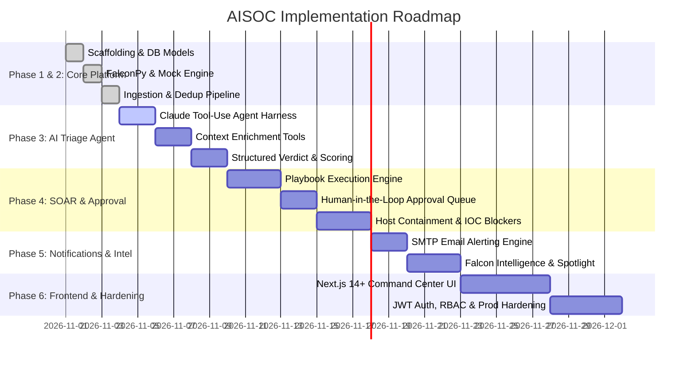

# Implementation & Execution Plan — AISOC

## 1. Phased Delivery Roadmap

---

## 2. Phase Breakdown & Deliverables

### Phase 1: Foundation & Scaffolding [COMPLETED]
- [x] Python virtual environment with FastAPI, SQLAlchemy 2.0, Pydantic v2, APScheduler.
- [x] Environment configuration management via `pydantic-settings` with secret protection.
- [x] Database model definitions for `Alert`, `Incident`, `Case`, `Action`, `AuditLog`, `IngestCheckpoint`.
- [x] Git repository initialization with structured commits and `.gitignore`.

### Phase 2: Ingestion & Telemetry Pipeline [COMPLETED]
- [x] CrowdStrike FalconPy OAuth2 integration for Alerts v2, Incidents, and Hosts.
- [x] High-fidelity Mock Falcon backend (`MockFalconClient`) generating MITRE ATT&CK scenarios.
- [x] Checkpointed background poller with FQL time-based query filtering and deduplication.
- [x] REST API endpoints (`/api/alerts`, `/api/incidents`, `/api/stats`, `/health/falcon`, `/api/ingest/run`).
- [x] Test suite passing with 100% pass rate on mocked and unit validation (12/12 passing).

### Phase 3: AI Triage Agent (Anthropic Claude) [NEXT UP]
- [ ] Implement `backend/app/ai/agent.py` using Anthropic Python SDK (`anthropic>=0.40`).
- [ ] Build read-only investigation tools in `backend/app/ai/tools.py`:
  - `get_host_details(device_id)`
  - `get_process_tree(composite_id)`
  - `lookup_threat_intel(indicator)`
  - `get_recent_alerts_for_host(device_id)`
- [ ] Define strict system prompt with threat investigation guidelines, output formatting, and prompt injection isolation.
- [ ] Persist AI verdict (`true_positive`, `false_positive`, `needs_review`), confidence score, and plain-English summary to database.

### Phase 4: SOAR Playbook Engine & Human-in-the-Loop Governance
- [ ] Construct declarative playbook runner (`backend/app/soar/engine.py`).
- [ ] Implement response action executors in `backend/app/soar/actions.py`:
  - **Host Containment**: `hosts.perform_action("contain", [device_id])`
  - **Lift Containment**: `hosts.perform_action("lift_containment", [device_id])`
  - **Custom IOC Block**: `iocs.create_iocs([{"value": hash_or_ip, "type": "sha256", "action": "prevent"}])`
  - **Real Time Response**: Session initialization and command execution (`rtr_admin`).
- [ ] Enforce risk tier guardrails: Destructive actions transition to `pending_approval` until an authorized analyst sends an approval request (`POST /api/actions/{id}/approve`).
- [ ] Immutable audit logging for every decision.

### Phase 5: Notifications & Extended Intel
- [ ] Integrate SMTP email dispatcher (`backend/app/integrations/email.py`) triggered on Critical/High severity detections and pending approvals.
- [ ] Falcon Intelligence feed integration (threat actor attribution and campaign mapping).
- [ ] Falcon Spotlight vulnerability correlation (mapping host CVEs to exploit attempts).

### Phase 6: Next.js Command Console & Hardening
- [ ] Scaffold Next.js 14+ (App Router) with TypeScript and Tailwind CSS in `frontend/`.
- [ ] Build responsive SOC dashboard (KPI metric tiles, real-time alert grid, slide-out triage drawer).
- [ ] Action Approval Queue UI with impact assessment preview and one-click execution.
- [ ] JWT authentication with role-based access control (`analyst` vs `admin`).
- [ ] Production Docker Compose orchestrating PostgreSQL, FastAPI backend, and Next.js frontend.

---

## 3. Verification & Acceptance Criteria
- **Unit & Integration Tests**: All unit tests must pass via `pytest` without requiring external internet or production credentials.
- **Mock / Production Parity**: Changing `FALCON_MOCK=false` and supplying API keys must work immediately with zero code changes.
- **Safety Verification**: No destructive Falcon API call can execute without a matching `decided_by` entry and approval event recorded in `audit_log`.

