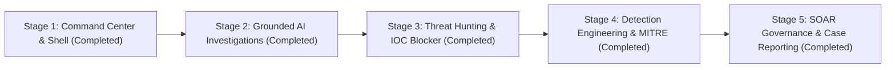

# Implementation & Execution Plan — Vektor (Enterprise In-House SecOps & SOAR)

## 1. Phased Delivery Roadmap

---

## 2. Phase Breakdown & Deliverables

### Stage 1: Foundation, Ingestion & Command Center Shell [COMPLETED]
- [x] Python 3.13 / FastAPI backend with SQLAlchemy 2.0, Pydantic v2, APScheduler.
- [x] Live CrowdStrike Falcon US-2 OAuth2 integration (`Alerts v2`, `Hosts`, `Intel`, `IOCs`).
- [x] Collapsible 8-module navigation sidebar (`Sidebar.tsx`) with zero generic AI/emoji clutter.
- [x] Executive Command Center (`SocOverview.tsx`) featuring:
  - Interactive **Network Topology & Attack Path Visualizer** (`NetworkTopology.tsx`).
  - **System Integrity & Controls Gauge** (`SystemIntegrityGauge.tsx`).
  - **6-Stage Incident Progression Timeline** (`IncidentProgressionTimeline.tsx`).
  - **Evidence-Grounded Security Briefing** (`AiSecurityBriefing.tsx`) with clickable alert citations.

### Stage 2: Deep Grounded AI Investigations [COMPLETED]
- [x] Tripartite Evidence Categorization in `AlertTriageDrawer.tsx`:
  - `[Observed]`: Direct telemetry fields verified by CrowdStrike Falcon.
  - `[Inferred]`: Analytical correlation, MITRE mapping, and confidence score.
  - `[Recommended]`: Human-gated response actions.
- [x] Visual **Process Execution Lineage** (`parent -> child -> command line`).
- [x] **Interactive Grounded Evidence Q&A** (`POST /api/alerts/{id}/chat`) answering analyst questions strictly from retrieved telemetry.

### Stage 3: Threat Hunting & Custom IOC Blocker [COMPLETED]
- [x] **Natural-Language to Falcon Query Language (NL-to-FQL / CQL)** translator (`POST /api/hunting/query`).
- [x] Query Explanation Gate previewing generated LogScale/FQL syntax prior to execution.
- [x] Live telemetry hunt results grid (`ThreatHuntingView.tsx`).
- [x] **Falcon Custom IOC Prevention Pusher** (`POST /api/hunting/ioc`) queuing SHA256, IPv4, and Domain blocks into the Response Center.

### Stage 4: Detection Engineering & MITRE ATT&CK Center [COMPLETED]
- [x] **MITRE ATT&CK v15 Coverage Strip** tracking active rules and live hit counts (`GET /api/detections/rules`).
- [x] Detection Rule Catalog (`DetectionRulesView.tsx`) covering Next-Gen SIEM Brute Force (`T1110.001`), Sensor ML (`T1204.002`), PowerShell (`T1059.001`), LSASS Dumping (`T1003.001`), and Shadow Copy Deletion (`T1490`).
- [x] **Rule Dry-Run & Validation Harness** (`POST /api/detections/test`) backtesting correlation logic against ingested tenant telemetry.

### Stage 5: SOAR Governance, Case Shift Notes & Executive Reporting [COMPLETED]
- [x] Human-in-the-loop **Response Center Approval Queue** (`ApprovalQueue.tsx`) with audit logging (`AuditLogView.tsx`).
- [x] **Analyst Shift Handover Notes** (`POST /api/cases/{id}/notes`) in `CasesView.tsx`.
- [x] One-click **Executive Incident Report (.md) Export** for CISO / management briefings.
- [x] Live **CrowdStrike Scope Diagnostics Runner** (`SettingsModal.tsx`).

---

## 3. Verification & Acceptance Criteria
- **Backend Test Suite**: `pytest` passes all unit and API tests (100% pass rate).
- **Frontend Production Compilation**: `npm run build` compiles cleanly with 0 TypeScript or ESLint errors.
- **Safety Governance**: Destructive containment and IOC prevention actions require explicit human authorization and write immutable records to `audit_log`.
